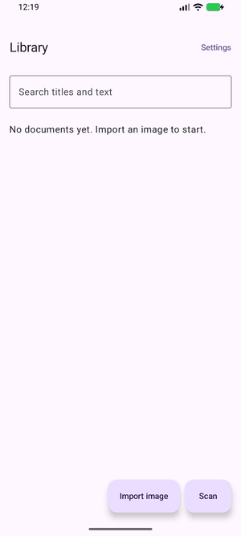
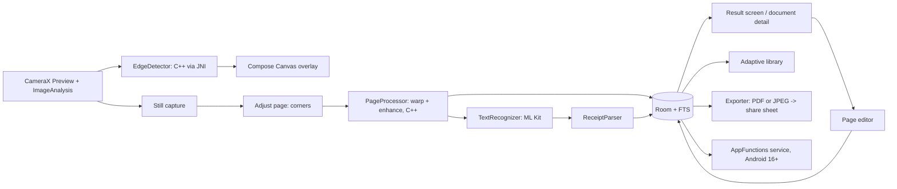

# document_scanner

Android receipt and document scanner with on-device ML, CameraX, native C++ edge detection and Jetpack Compose Canvas overlays for edges and measurements. Everything runs on the device.


[](https://github.com/MaBoRokun/document_scanner/actions/workflows/ci.yml)
[](https://github.com/MaBoRokun/document_scanner/releases)
<!-- Badges for private repos render only for signed-in collaborators. -->



*Recorded on an Android 17 emulator with its built-in test camera scene, so the "page" is a cartoon house, not a document,
and on an earlier build of the UI. Receipts and pages used by the tests are synthetic images made by
[`tools/generate_synthetic.py`](tools/generate_synthetic.py).*

> **Privacy:** no network permission, no analytics, no cloud. See [Privacy](#privacy).

## What it does

- **Live scan.** CameraX preview with a native C++ page detector. A Compose `Canvas` overlay draws the page outline,
  draggable corner handles and edge lengths, coloured by detection confidence.
- **Measurements.** Edge lengths in relative units, or an estimated size in millimetres once you choose A4, Letter or an
  80 mm receipt roll. Always labelled as an estimate, with hints for tilt, blur, distance and wrong proportions.
- **Scan flow.** Scan, then *Adjust page* (move the corners, retake or save), then a **result screen** showing the new
  document: edit the page, choose its type, add a comment, read the recognised text, add more pages (which runs the same
  flow again), share, and press **Done** to finish.
- **Page editor.** Crop (corners), brightness, Original / Document / Black & white, colour filters and a pen. Edits are
  re-rendered from the kept original photo, so nothing degrades, and Undo is always available.
- **Text.** On-device OCR (ML Kit, bundled model) and receipt heuristics for merchant, date and total, shown as editable
  fields. The recognised text of the page you are looking at can be selected and copied.
- **Library.** Room database with full-text search over titles, merchants, comments and recognised text; multi-page
  documents; a colour-coded type per document (receipt, passport / ID, book page, A4 page, document, other) with a filter
  row; swipe to delete, long-press to select several.
- **Sharing.** One *Share* button with a dialog: the current page as an image, the current page as a PDF, or the whole
  document as a PDF. Several documents can be shared as one PDF from the library. Everything goes through the system
  share sheet, with progress and cancellation.
- **Adaptive.** List and document side by side on wide windows, one pane on phones, resizable windows and foldables.
- **Languages.** English, German, French, Portuguese and Spanish. The app follows the system language; on Android 13+ it
  can also be set per app in the system settings.
- **Light theme only.** The app does not follow the system's dark mode (the scanner canvas itself is dark by design).
- **Quick scan (optional).** Google's ML Kit Document Scanner as a second engine, when Google Play services exist.
- **Assistants (optional, Android 16+, off by default).** `searchDocuments(query)` through AppFunctions; titles, dates and totals only.

## Architecture



| Module | Role |
|---|---|
| `app` | Composition root: Koin wiring, navigation, adaptive host |
| `domain` | Pure Kotlin: models, use cases, receipt parser, classifier, quad math, measurements, smoothing, interfaces |
| `data` | Room schema and repository, private image store, PDF and image export, settings |
| `vision` | C++ edge detector, warp, enhancement and page rendering behind domain interfaces (JNI) |
| `ocr` | ML Kit text recognizer adapter |
| `feature-scan` | Camera, permissions, live overlay, adjust-page step, Quick scan |
| `feature-library` | Library, search, document detail and result screen, adaptive list-detail |
| `feature-export` | Export screen and share sheet |
| `feature-editor` | Page editor: crop, brightness, colour filters, pen, undo |
| `feature-settings` | Engine, paper format, assistants switch, privacy |
| `appfunctions` | AppFunctions service (API 36+, alpha library, off by default) |
| `core:common`, `core:designsystem` | Dispatchers and result helpers; theme, dialogs, category colours, overlay drawing |

Rules (see [CONTRIBUTING.md](CONTRIBUTING.md)): `domain` has no Android; features depend only on `domain` and `core`; `app`
is the only module that sees implementations. UI text lives in string resources. Decisions are recorded in
[docs/adr](docs/adr).

## Install

1. Open the repository's **Releases** page and download the latest `.apk`
   (a file named `...DEBUG-SIGNED-NOT-FOR-RELEASE.apk` is a debug build made without release signing secrets).
2. On the phone, allow installing apps from unknown sources for the app you used to open the file.
3. Open the APK and confirm the install.

Every push to `main` also uploads a debug APK as a workflow artifact (kept 14 days) on the
**Actions → APK (debug)** run page. This repository is private, so you must be signed in to GitHub to download.

Requires Android 8.0 (API 26) or newer. Built for Android 17 (API 37).

## Build and test

JDK 17+ and the Android SDK (API 37, the NDK and CMake are installed by Gradle when missing).

```bash
./gradlew ktlintFormat                # ktlint is strict: format first, then check
./gradlew ktlintCheck detekt lint     # style, static analysis, Android lint
./gradlew testDebugUnitTest           # unit tests (JVM, Robolectric) and screenshot checks (Roborazzi)
./gradlew testDebugUnitTest -Proborazzi.record   # re-record screenshot baselines after an intended UI change
./gradlew check                       # everything above plus coverage gate and the no-INTERNET gate
./gradlew :app:assembleDebug          # debug APK
bash tools/check_apk.sh app/build/outputs/apk/debug/app-debug.apk   # APK smoke check
```

Instrumented tests (native code, camera-free pipeline, OCR on a real engine, PDF, Compose pixels and window sizes) need an emulator:

```bash
./gradlew pixel6api34DebugAndroidTest   # managed device, Android 14
./gradlew :appfunctions:pixel6api37DebugAndroidTest   # Android 17 image: app function indexing (slow first boot)
# or, with an emulator already running:
./gradlew connectedDebugAndroidTest
```

## CI/CD

| Workflow | Runs on | What it does |
|---|---|---|
| [`ci.yml`](.github/workflows/ci.yml) | every pull request and push to `main` | ktlint, detekt, Android lint, unit and screenshot tests, coverage gates, debug build, APK smoke check |
| [`apk-debug.yml`](.github/workflows/apk-debug.yml) | push to `main`, manual | builds the debug APK and uploads it as an artifact (14 days) |
| [`release.yml`](.github/workflows/release.yml) | tags `v*.*.*` | builds a signed APK and AAB when the signing secrets exist (otherwise a debug-signed APK, named as such), writes checksums and creates a GitHub Release |

Workflows use least-privilege `permissions`, cancel superseded runs, never use `pull_request_target`, and use current
versions of the third-party actions (Dependabot keeps them and the Gradle dependencies up to date).

## Privacy

- The manifest **never** declares `INTERNET`. Libraries that ask for it (ML Kit) are overruled with `tools:node="remove"`,
  and the build task `check<Variant>NoInternetPermission` plus [`tools/check_apk.sh`](tools/check_apk.sh) fail if it comes back.
- No analytics, no accounts, no cloud OCR, no network calls.
- Documents, recognised text and exports live in the app's private storage until you share them yourself.
- Quick scan is optional. Google Play services runs that scanner and may fetch its own model; this app still has no network permission.
- Assistant access (AppFunctions) is off by default, available only on Android 16+, and returns titles, dates, totals and page counts only.
- Test documents are synthetic; the repository contains no real documents, patient data or secrets.

## Assistants (AppFunctions)

`searchDocuments(query)` is declared in [`appfunctions`](appfunctions) with `isEnabled = false`. Turn it on in **Settings** on
an Android 16+ device, then check it from a computer:

```bash
adb shell cmd app_function list-app-functions | grep -A 10 io.github.maborokun.docscanner
adb shell "cmd app_function execute-app-function --package io.github.maborokun.docscanner \
  --function 'io.github.maborokun.docscanner.appfunctions.BaseDocumentSearchService#searchDocuments' \
  --parameters '{\"query\": \"bakery\"}'"
```

AppFunctions is an alpha library (1.0.0-alpha13) and its API changes between releases; see [ADR-008](docs/adr/008-appfunctions.md).

## Test data

`python tools/generate_synthetic.py` regenerates `fixtures/synthetic`: fake receipts with ground truth and "photographed"
pages with known corners. Everything is seeded, so the output is identical on every run.

## Known limits

- Exported PDFs are images only (no hidden text layer), so they are not searchable inside a PDF reader.
- Quick scan: the engine switch, the fallback without Play services, launching Google's scanner and cancelling were checked on an
  Android 17 emulator; Google's scanner could not fetch its module there, so importing pages from it is only unit tested.
- Edge detection is classical (global Otsu threshold, hull, line fit). It expects a page that is clearly lighter or darker
  than its surroundings; strong lighting gradients or a page on a similar background can fool it.
- OCR runs ML Kit's Latin model only (it reads all five app languages, not other scripts), and receipt parsing covers common
  English/German formats, not every locale.
- Translations have not been reviewed by native speakers. The default title of a new document ("Scan 2026-10-15") and the
  category suggestion under the search field stay English; see [ADR-011](docs/adr/011-localization.md).
- Real-device camera behaviour (focus, exposure, performance) was checked on emulators only; OCR of one photo takes about 15 s on the
  software-rendered emulator and is much faster on hardware.
- Coverage (89.4%, gate 75%) counts what host tests can run. Compose screens, the camera session, JNI and ML Kit adapters are
  excluded from the figure and covered by instrumented tests instead.

## Layout and docs

[TECHNICAL_PLAN.md](TECHNICAL_PLAN.md) is the original design and milestone plan; [docs/adr](docs/adr) records decisions made on the way;
[docs/design.md](docs/design.md) describes the visual design; [CONTRIBUTING.md](CONTRIBUTING.md) lists the rules for changes.
