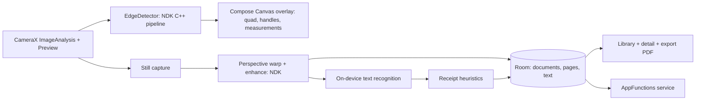

# ondevice-doc-scanner: Technical Plan

> Status: planning. Versions verified on 2026-10-05 (see section 5). Re-verify at the start of every milestone.
> Everything runs on-device. Synthetic documents only (generated test receipts/pages); no real personal documents in the repo, tests or screenshots.

## 1. Purpose and portfolio goal

An Android receipt/document scanner showing: on-device ML, CameraX, a Jetpack Compose Canvas overlay for live edges and measurements, native C++ (NDK) image processing, Room, PDF export, adaptive layouts, and a modern Android API (AppFunctions). Closes these gaps: Compose depth (Canvas, custom drawing, gestures), on-device AI, NDK/C++ in a visible project, clean architecture, testing and CI/CD with a shipped APK.

## 2. Scope

### MVP
- **Live scan:** CameraX preview with real-time document edge detection; a Compose `Canvas` overlay draws the detected quadrilateral, corner handles and edge-length labels.
- **Capture + correct:** capture a still, perspective-correct (warp) to a flat page, enhance (contrast/binarize), user can adjust corners by dragging handles.
- **Measurements overlay:** edge lengths in relative units; with a chosen paper format (A4, Letter, receipt roll width) show an estimated real size and a skew/quality hint. Labelled as an estimate.
- **Text:** on-device OCR; simple receipt heuristics (total, date, merchant guess) shown as editable fields.
- **Library:** Room database of documents, thumbnails, search by text, delete.
- **Export:** multi-page PDF export and share sheet.
- **Quick-scan mode:** Google's ML Kit Document Scanner as an alternative engine (needs Google Play services), selectable in settings.
- **AppFunctions:** one function, `searchDocuments(query)`, exposed to on-device assistants (see section 6).
- **Adaptive layouts:** list-detail on large screens, resizable windows (Android 17 ignores orientation/resizability restrictions on large screens when targeting API 37).
- **Privacy:** no network permission; no analytics; no cloud.

### Non-goals
- Cloud sync, accounts, ads, analytics, payments.
- Cloud OCR or any network call.
- Handwriting recognition, table extraction, full accounting features.
- Car/automotive or display-specific work; Wear OS/TV.

## 3. Targets

| Target | Role | Built where |
|---|---|---|
| Android phone/tablet/foldable (minSdk 26, target/compile 37) | The app | Local + CI |
| Instrumented/host tests | JVM + Robolectric/instrumented where needed | CI (host tests) |

## 4. Architecture



### Module tree
```
ondevice-doc-scanner/
  build-logic/
  app/                    com.android.application: DI wiring, navigation, adaptive scaffold
  core/
    common/               AppDispatchers, Result types
    designsystem/         theme + Canvas drawing helpers
  domain/                 pure Kotlin: Document, Page, Quad, DetectionResult, use cases, interfaces
  data/                   Room, repositories, file storage (app-private), PDF writer
  vision/                 EdgeDetector, perspective warp, enhance: Kotlin API + NDK C++ (CMake)
  ocr/                    TextRecognizer wrapper + ReceiptParser (parser is pure Kotlin, in domain tests)
  feature-scan/           camera screen + overlay
  feature-library/        list, search, detail (adaptive)
  feature-export/         PDF export + share
  feature-settings/       engine choice, paper formats, privacy info
  appfunctions/           AppFunctions service (API 36+ guarded)
  docs/adr/
```

### Dependency rules
1. `domain` is pure Kotlin (no Android, no Compose, no Room).
2. `vision` exposes only domain types (`Quad`, `FrameInfo`); C++ is hidden behind a Kotlin interface so detection is fake-able in tests.
3. `feature-*` depend on `domain` + `core:*`; no direct dependency between features.
4. `data` implements domain interfaces; `app` is the only composition root (Koin or Hilt decided in ADR-001).
5. Camera/ML/AppFunctions Android classes never appear in `domain`.

## 5. Tech stack (verified 2026-10-05)

| Library | Purpose | Version | Source | Why |
|---|---|---|---|---|
| Kotlin | Language | 2.4.20 | [releases](https://github.com/JetBrains/kotlin/releases/tag/v2.4.20) | Latest stable |
| Gradle | Build | 9.8.0 | [versions/current](https://services.gradle.org/versions/current) | AGP 9.4 needs ≥ 9.6.0 |
| Android Gradle Plugin | Build | 9.4.1 | [Google Maven](https://dl.google.com/dl/android/maven2/com/android/tools/build/gradle/maven-metadata.xml), [notes](https://developer.android.com/build/releases/agp-9-4-0-release-notes) | Latest stable |
| JDK | Toolchain | 17 (AGP 9.4 minimum) | [AGP notes](https://developer.android.com/build/releases/agp-9-4-0-release-notes) | Matches CI |
| NDK | C++ vision code | 28.2.13676358 (AGP 9.4 default) | [AGP notes](https://developer.android.com/build/releases/agp-9-4-0-release-notes) | Default for this AGP |
| compileSdk / targetSdk | Android API | 37 (Android 17) | [behavior changes](https://developer.android.com/about/versions/17/behavior-changes-17) | Resizability is mandatory on large screens |
| Compose BOM | Compose versions | 2026.09.00 | [Google Maven](https://dl.google.com/dl/android/maven2/androidx/compose/compose-bom/maven-metadata.xml) | Latest stable BOM |
| Material3 adaptive | Adaptive layouts | 1.3.0 | [Google Maven](https://dl.google.com/dl/android/maven2/androidx/compose/material3/adaptive/adaptive/maven-metadata.xml) | List-detail scaffold |
| Navigation 3 | Navigation | 1.2.0 | [Google Maven](https://dl.google.com/dl/android/maven2/androidx/navigation3/navigation3-runtime/maven-metadata.xml) | Latest stable (confirm in ADR-002) |
| Lifecycle (ViewModel) | State holders | 2.11.0 | [Google Maven](https://dl.google.com/dl/android/maven2/androidx/lifecycle/lifecycle-viewmodel/maven-metadata.xml) | Stable |
| Activity Compose | Activity integration | 1.13.0 | [Google Maven](https://dl.google.com/dl/android/maven2/androidx/activity/activity-compose/maven-metadata.xml) | Stable |
| CameraX | Camera | 1.6.2 (1.7 is alpha) | [Google Maven](https://dl.google.com/dl/android/maven2/androidx/camera/camera-core/maven-metadata.xml) | Stable pick |
| LiteRT | On-device ML runtime (Google's TFLite successor) | 2.2.0 | [docs](https://developers.google.com/edge/litert), [Google Maven](https://dl.google.com/dl/android/maven2/com/google/ai/edge/litert/litert/maven-metadata.xml) | Optional learned corner/quality model; API 24+ |
| ML Kit Document Scanner | Quick-scan engine | 16.0.0 | [docs](https://developers.google.com/ml-kit/vision/doc-scanner/android), [Google Maven](https://dl.google.com/dl/android/maven2/com/google/android/gms/play-services-mlkit-document-scanner/maven-metadata.xml) | Turnkey scan UI; needs Play services, API 21+, ≥ 1.7 GB RAM |
| ML Kit Text Recognition | OCR | verify at M5 | [ML Kit docs](https://developers.google.com/ml-kit/vision/text-recognition/v2/android) | Choose bundled model (no download) if still offered; decision in ADR-003 |
| AppFunctions | Assistant integration | 1.0.0-alpha12 (alpha) | [release notes](https://developer.android.com/jetpack/androidx/releases/appfunctions), [guide](https://developer.android.com/ai/appfunctions) | Android 16+ (`@RequiresApi(36)`), experimental preview |
| KSP | Annotation processing (Room, AppFunctions) | 2.3.12 | [Maven Central](https://repo1.maven.org/maven2/com/google/devtools/ksp/symbol-processing-api/maven-metadata.xml) | Required by Room/AppFunctions |
| Room | Local DB | 2.8.5 | [Room releases](https://developer.android.com/jetpack/androidx/releases/room) | Stable |
| kotlinx-coroutines | Concurrency | 1.11.0 | [release](https://github.com/Kotlin/kotlinx.coroutines/releases/tag/1.11.0) | Standard |
| Turbine | Flow tests | 1.2.1 | [release](https://github.com/cashapp/turbine/releases/tag/1.2.1) | Flow tests |
| MockK | Unit test mocks | 1.14.11 | [Maven Central](https://repo1.maven.org/maven2/io/mockk/mockk/maven-metadata.xml) | JVM/Android tests |
| Kover | Coverage | 0.9.11 | [Maven Central](https://repo1.maven.org/maven2/org/jetbrains/kotlinx/kover-gradle-plugin/maven-metadata.xml) | Coverage |
| ktlint Gradle plugin | `ktlintCheck` | 14.2.0 | [release](https://github.com/JLLeitschuh/ktlint-gradle/releases/tag/v14.2.0) | Format check |
| detekt | Static analysis | 2.0.0-alpha.6 or 1.23.8 | [Maven Central](https://repo1.maven.org/maven2/dev/detekt/detekt-gradle-plugin/maven-metadata.xml) | See R3 |
| GitHub Actions | CI | checkout v7.0.1, setup-java v6.0.1, gradle/actions v6.4.0, upload-artifact v7.0.1, download-artifact v8.0.1 | [gradle/actions](https://github.com/gradle/actions/releases) and others | First-party/Gradle-official only |

Open decision (ADR-001): Koin vs Hilt for DI. Koin 4.2.2 is the default for consistency with the other repos ([release](https://github.com/InsertKoinIO/koin/releases/tag/4.2.2)).

## 6. Data and API

### Domain models
```
Document(id, title, createdAt, pageCount, extractedFields: ReceiptFields?)
Page(id, documentId, index, imagePath, width, height, ocrText, quad: Quad)
Quad(topLeft, topRight, bottomRight, bottomLeft)           // normalized 0..1 coordinates
ReceiptFields(merchant?, date?, total?, currency?, confidence)
DetectionResult(quad?, confidence, skewDegrees, blurScore, frameSize)
```

### Room schema (v1)
`document(id, title, createdAt, merchant, totalMinor, currency, date)`, `page(id, documentId FK, idx, imagePath, width, height, quadJson)`, `page_fts` (FTS4/FTS5 over OCR text). Images live in app-private storage; the DB stores paths only. Migrations tested.

### Vision API (Kotlin interface over NDK)
```kotlin
interface EdgeDetector { suspend fun detect(frame: Frame): DetectionResult }
interface PageProcessor { suspend fun warp(image: Bitmap, quad: Quad, outSize: Size): Bitmap; suspend fun enhance(b: Bitmap, mode: EnhanceMode): Bitmap }
```
C++ pipeline (own code): grayscale → blur → adaptive threshold/Canny → contour approximation → largest convex quadrilateral → confidence from area/aspect/edge strength. Optional LiteRT model can replace/validate it (ADR-004), only with an openly licensed model recorded in `docs/`.

### AppFunctions (one action)
`@AppFunction suspend fun searchDocuments(query: String): List<DocumentSummary>` returning titles, dates and totals only (no images, no full text). Guarded for API 36+, off by default behind a settings toggle, documented in README. **Verify before implementation:** artifact coordinates, current alpha version, min SDK and permission model at [developer.android.com/ai/appfunctions](https://developer.android.com/ai/appfunctions); the plan assumes the docs as read on 2026-10-05.

## 7. Concurrency design

- Dispatchers injected (`AppDispatchers`).
- **Frame analysis:** `ImageAnalysis` with `STRATEGY_KEEP_ONLY_LATEST` on a dedicated single-thread executor; detection results flow through a conflated `StateFlow<DetectionResult>`; the overlay collects with `collectAsStateWithLifecycle`. Backpressure = drop frames, never queue them.
- **Smoothing:** quad low-pass filtering in a `scan` operator on the flow (no shared mutable state).
- **Heavy work:** warp/enhance/OCR on `Dispatchers.Default` with `limitedParallelism(2)`; native calls are blocking, so wrapped in `withContext`; cancel on screen exit.
- **Pipeline per capture:** `capture → warp → (enhance ∥ OCR) → persist` using `coroutineScope { async {} }`; failure of OCR doesn't lose the page.
- **PDF export:** `Flow<ExportProgress>` on IO with cancellation; temp file cleaned in `finally`.
- **Native thread-safety:** C++ code is stateless per call (no globals) so calls are re-entrant.
- **Lifecycle:** camera bound to lifecycle; analysis stops when the app is backgrounded.

## 8. Testing strategy

| Layer | Tooling | Target |
|---|---|---|
| Domain (receipt parser, quad math, measurements) | JUnit/`kotlin.test`, table-driven with synthetic receipts | ≥ 90% |
| Vision (C++ via JNI) | Instrumented tests on generated synthetic images (rotated/skewed rectangles) + golden outputs; pure-Kotlin fake for unit tests | Corner error ≤ tolerance on fixture set |
| Repositories/Room | In-memory Room, migration tests | ≥ 80% |
| ViewModels | `runTest`, Turbine | ≥ 80% |
| Compose UI | `compose.ui.test` on host/instrumented | Smoke test per screen; overlay drawing tested with semantics/pixel checks |
| Screenshot tests | Tool chosen in ADR-005 (candidates: Compose Preview Screenshot Testing, Roborazzi; verify stability) | Overlay, library, adaptive layouts |
| Adaptive | Window-size-class tests (compact/medium/expanded) | Required |
| Performance | Macrobenchmark optional; frame-analysis time logged | Tracked |
| Static | `lint`, `ktlintCheck`, `detekt` | CI-gated |
| Coverage | Kover | ≥ 75% overall |

Test documents are generated by a script in the repo (synthetic receipts); never real documents.

## 9. CI/CD and release (Phase 3 summary)

- `ci.yml`: JDK 17, setup-gradle, install NDK/CMake as needed (verify cache), `ktlintCheck`, `detekt`, `lint`, `testDebugUnitTest`, `assembleDebug`; upload reports.
- `apk-debug.yml`: debug APK as artifact (14 days) + job-summary link on every push to `main`, plus manual dispatch.
- `release.yml` on tag `v*.*.*`: release APK + AAB; signed only when `ANDROID_KEYSTORE_BASE64`, `KEYSTORE_PASSWORD`, `KEY_ALIAS`, `KEY_PASSWORD` exist (owner adds them), otherwise a clearly labelled debug-signed APK; GitHub Release with generated notes, APK/AAB, SHA-256 checksums. `contents: write` only in the release job.
- If the SDK build tools are available on the runner, run `aapt2 dump badging` on the APK as a smoke check.
- `dependabot.yml`, templates, badges, README Install section (enable "install unknown apps").
- No desktop or iOS workflows for this repo.

## 10. Milestones

### M0: Skeleton and decisions
**Acceptance:** `./gradlew assembleDebug test` green; CI green; app launches to an empty scaffold.
- [ ] Re-verify versions in section 5
- [ ] Wrapper, catalog, convention plugins, modules per section 4
- [ ] ADR-001 DI, ADR-002 navigation, ADR-003 OCR engine, ADR-004 detector approach, ADR-005 screenshot tool
- [ ] `ci.yml` green

### M1: Domain + library (no camera)
**Acceptance:** import a synthetic image as a document, list, search, delete; domain 90% covered.
- [ ] Domain models + use cases
- [ ] Room schema + FTS search + repository
- [ ] Library list/detail screens

### M2: CameraX preview + permission flow
**Acceptance:** live preview with permission handling on phone and tablet.
- [ ] `feature-scan` skeleton, lifecycle binding
- [ ] Permission rationale/denied states
- [ ] Capture to app-private storage

### M3: NDK edge detection
**Acceptance:** fixture set of synthetic skewed pages detected within tolerance; JNI wrapped behind `EdgeDetector`.
- [ ] CMake build, C++ pipeline, JNI bridge
- [ ] Fake detector for unit tests
- [ ] Instrumented fixture tests

### M4: Compose Canvas overlay + measurements
**Acceptance:** overlay follows the page at camera frame rate; handles drag; measurement labels visible and labelled "estimate".
- [ ] Canvas quad, handles, gestures
- [ ] Smoothing flow, confidence colouring
- [ ] Paper-format measurements

### M5: Warp, enhance, OCR, receipt parsing
**Acceptance:** captured page is flattened, OCR text stored, fields extracted from synthetic receipts.
- [ ] `PageProcessor` (NDK) warp + enhance
- [ ] OCR integration per ADR-003
- [ ] Receipt parser with fixtures; editable fields UI

### M6: PDF export, multi-page, share
**Acceptance:** multi-page PDF exported and shared; progress and cancellation work.
- [ ] Multi-page capture flow
- [ ] PDF writer + `Flow<ExportProgress>`
- [ ] Share sheet

### M7: Adaptive layouts + settings + quick-scan engine
**Acceptance:** list-detail on expanded windows, resizable multi-window; ML Kit engine selectable when Play services present.
- [ ] Adaptive scaffold + window-size tests
- [ ] Settings: engine, paper formats, privacy screen
- [ ] ML Kit Document Scanner integration with graceful fallback

### M8: AppFunctions
**Acceptance:** `searchDocuments` discoverable on an API 36+ emulator/device; disabled by default.
- [ ] Verify current AppFunctions docs/coordinates first
- [ ] Service + serializable summary types, settings toggle
- [ ] Tests with `appfunctions-testing`, README section

### M9: Release automation and polish
**Acceptance:** tag `v0.1.0` produces APK/AAB and checksums on a GitHub Release; README has GIF and privacy section.
- [ ] Phase 3 workflows green
- [ ] README: GIF, diagram, Install section, privacy statement
- [ ] Screenshot baselines, coverage badge

## 11. Definition of done

README with GIF, architecture diagram and privacy section; tests green, coverage ≥ 75%; release APK/AAB with checksums on GitHub Releases; ADRs recorded; manifest has no `INTERNET` permission; no secrets, real documents or employer material.

## 12. Risks and open questions

| # | Risk / question | Mitigation |
|---|---|---|
| R1 | AppFunctions is alpha / experimental and API 36+ only | Isolated module, feature-flagged, version re-check in M8 |
| R2 | ML Kit Document Scanner requires Google Play services | Optional engine; custom pipeline is the default |
| R3 | detekt 2.0 alpha vs 1.23.8 with Kotlin 2.4 | ADR in M0 |
| R4 | NDK build time/caching in CI | Cache via setup-gradle; limit ABIs for debug builds |
| R5 | No suitable openly licensed ML model for corner detection | Classical C++ pipeline is the baseline; LiteRT is optional |
| R6 | OCR engine choice (bundled vs downloadable model) | ADR-003; prefer fully offline |
| R7 | CameraX 1.7 alpha vs 1.6.2 stable | Stay on stable unless a needed feature requires alpha |
| Q1 | Koin vs Hilt | ADR-001 |

## 13. Kickoff prompt (M1)

```
Read TECHNICAL_PLAN.md and CLAUDE.md in this repo first. Milestone M0 is complete and CI is green.
Implement milestone M1 (domain + library without camera) exactly as specified in section 10.
Rules: re-verify versions before adding dependencies; `domain` stays pure Kotlin; inject dispatchers; synthetic
documents only (generate them with a script); no INTERNET permission; no secrets. Run ./gradlew ktlintCheck
detekt lint testDebugUnitTest assembleDebug before each push and stop when the M1 acceptance criteria are met.
Report what you ran and the results.
```
